# CubeOCC — Source of Truth

This vault is the living project specification. It separates **confirmed decisions**, **V1 implementation**, **optional/V2 experiments**, **open questions**, and **superseded ideas**.

> [!important]
> If something conflicts with `01_CONFIRMED_REQUIREMENTS.md`, the confirmed-requirements note wins.

## Navigation

### Confirmed requirements and protocol

- [[01_CONFIRMED_REQUIREMENTS]]
- [[02_OPEN_QUESTIONS]]
- [[03_FRAME_AND_LINK_PROTOCOL]]
- [[04_CAMERA_ROI_AND_CALIBRATION]]
- [[05_V1_STREAMING_PIPELINE]]
- [[06_OPTIONAL_PARALLEL_PIPELINES]]

### ECC and sender tools

- [[07_ECC_AND_METRICS]]
- [[07_01_SENDER_BITSTREAM_TOOL]]
- [[07_02_SENDER_BITSTREAM_TESTING]]
- [[07_03_SENDER_FRAME_MAPPING]]
- [[07_04_SENDER_FRAME_PLAYER]]
- [[15_25_FPGA_UART_OUTPUT_AND_SIM_DECODER]]
- [[07_05_FULL_FRAME_GENERATION_WALKTHROUGH]]

### Simulation, experiments, and planning

- [[08_SIMULATION_CAMERA_MODEL]]
- [[09_IMAGE_PROCESSING_EXPERIMENTS]]
- [[10_ADAPTIVE_TRANSMISSION_EXPERIMENT]]
- [[11_VERIFICATION_CHECKLIST]]
- [[12_DECISION_LOG]]
- [[13_MONTH_PLAN]]
- [[14_GLOSSARY]]

### Task backlog and roadmap

- [[15_TASK_BACKLOG]]
- [[16_VERSION_ROADMAP]]

### Dataset and ROI tooling

- [[15_01_MONITOR_CAPTURE_DATASET_LABELING]]
- [[15_02_ROI_WARP_AND_DEGRADATION_TOOL]]
- [[15_04_MANUAL_ROI_CORNER_REVIEW]]

### FPGA ROI detector and review

- [[15_05_FPGA_START_ROI_DETECTOR]]
- [[15_06_SOURCES_AND_FPGA_UI]]
- [[15_07_XSIM_RTL_ROI_REVIEW]]
- [[15_08_FPGA_CAMERA2_GRAYSCALE_GRID_REVIEW]]

### V2 classifier and image processing

- [[15_09_V2_DYNAMIC_THRESHOLD_BASELINE_FINDINGS]]
- [[15_10_V2_CLASSIFIER_PIPELINE_ARCHITECTURE]]
- [[15_11_V2_TRAINING_VALIDATION_COMMANDS]]
- [[15_12_V2_WORK_LOG_DECISIONS_AND_REJECTIONS]]
- [[15_13_V2_TASK_CHECKLIST]]
- [[15_14_V2_SCRIPT_OUTPUTS_LOG]]
- [[15_15_V2_NONLINEAR_SVM_SESSION]]
- [[15_16_FEATURE_CORRELATION_PCA]]
- [[15_17_RECENT_V2_BRANCH_MERGE_SUMMARY]]
- [[15_18_LATEST_GRID_SVM_RETRAIN]]
- [[17_V2_IMAGE_PROCESSING_ANSWERS_FOR_MOHSEN]]

## Current V1 concept

```mermaid
flowchart LR
    BTN[Simulated button] --> TX[START / DATA / END optical frames]
    TX --> C1[Camera 1\nGrayscale / ROI / feedback\n~60 FPS target]
    TX --> C2[Camera 2\nData camera\n~30 FPS target]
    C1 --> CAL[ROI + marker geometry\nbrightness + confidence]
    CAL --> REG[Camera 2 sensor ROI registers]
    REG --> C2
    C2 --> STREAM[ROI pixel stream only]
    STREAM --> IP[Image processing]
    IP --> WARP[Warp from markers]
    WARP --> GRID[Grid extraction]
    GRID --> AVG[Per-cell grayscale averaging]
    AVG --> CLASS[Grayscale/on-off recovery]
    CLASS --> LINK[START / DATA / END decoder]
    LINK --> ECC[ECC decode]
    ECC --> OUT[Recovered ordered bitstream + metrics]
```



## V1 philosophy

1. One streaming pipeline first.
2. No full raw-frame buffering in the baseline, except the explicit low-resolution BRAM buffer used by the FPGA perspective-warp experiment.
3. Camera 2 uses sensor-level ROI windowing.
4. Keep reduced information whenever possible: per-cell sums/averages, symbols, decoded bits.
5. Benchmark first; add parallel workers only if one pipeline cannot keep up.
6. Treat glare as a channel impairment to measure, not something V1 promises to correct.

## Current implementation checkpoint

### FPGA pipeline (V1)

The latest verified FPGA simulation milestone is documented in [[15_08_FPGA_CAMERA2_GRAYSCALE_GRID_REVIEW]]. The directly connected XSim path runs:

```text
real GRAY8 camera frame
  -> FPGA ROI detector
  -> live four-corner signals
  -> FPGA projective warp
  -> FPGA 8x8 grid mapper
  -> browser review and manual labels
```

All 807 dataset frames completed structurally in the corrected projective XSim run, producing 51,648 cell records.

### V2 classifier (verified on the current golden)

The current V2 classifier replaces the original `dynamic_threshold_sampler` with a division-free linear rule (`linear_rule_sampler.sv`). All numbers below are on the current golden (`symbols_review.json` after the `MLCAP_054/frame_9.png` removal).

**Cell-level results:**

- All-cell error: 3.87 % (dynamic_threshold) → **0.63 %** (retrained linear rule + START map)
- Sets with zero errors: 29/62 → 38/62
- **6.1× error reduction**

**Classifier cross-validation (payload cells, leave-one-capture-set-out):**

- method I (`[m_w, nb_w]`, 2 features) + START white map: **0.85 %**
- method I + opt4 preprocessing: 1.49 %
- method G (`[mean, var, mx, mn, nb, white, lo, hi]`, 8 features): 1.36 %
- method I + RBF (100 Nystroem components): 1.27 % — **not FPGA-feasible** (~30k LUT for `exp()`)
- method I + poly2: 1.55 % — worse than linear
- method K (E-reduced, 3 features): 1.52 % — worse than method I

**Ambiguity flag (kind=5, current golden):**

- Recall: 89.3 % of bad frames caught
- Precision: 52.1 %
- FPR: 3.8 % of good frames lost
- Combined with guard discard: 92.9 % bad removed, 3.8 % good lost

**FPGA resources (Vivado OOC synthesis, `xc7a35t`):**

- Slice LUTs: 9,233 (44.4 %)
- Slice Registers: 4,308 (10.4 %)
- Block RAM: 8 tiles (16.0 %)
- DSP: 17 (18.9 %)

**Verification:**

- Bit-exact RTL vs integer model: PASS, 0 mismatch over 806 frames
- Ambiguity `(δ, N) = (0.069, 2)` cross-validated: held-out 86.5 % err removed (train 87.3 %)

**Chosen white reference:** per-cell map from the START frame, retrained on the latest live RTL ROI/warp/grid output, reaches 0.85 % capture-set CV error.

Full architecture and history:

- [[15_10_V2_CLASSIFIER_PIPELINE_ARCHITECTURE]] — pipeline and RTL
- [[15_11_V2_TRAINING_VALIDATION_COMMANDS]] — reproduction commands
- [[15_12_V2_WORK_LOG_DECISIONS_AND_REJECTIONS]] — decisions and rejections
- [[15_14_V2_SCRIPT_OUTPUTS_LOG]] — consolidated raw outputs
- [[15_15_V2_NONLINEAR_SVM_SESSION]] — RBF, poly2, Gaussian exploration
- [[15_16_FEATURE_CORRELATION_PCA]] — feature correlation and PCA analysis
- [[15_18_LATEST_GRID_SVM_RETRAIN]] — current ROI/warp/grid retraining and RTL verification

Open tasks: [[15_13_V2_TASK_CHECKLIST]]

Repository checkpoints:

- V1 pipeline: commit `70d96ec`
- V2 linear rule: commit `43a35b9`
- V2 START white map: commit `20818a7`
- V2 ambiguity flag: commit `78c0785`
- Complete V2 branch merge and documentation: commit `0a5a0af`

## Version Direction

- **V1**: grayscale/on-off averaging, image-backed camera simulation, I2C ROI, DVP and MIPI-style comparison models.
- **V1.5**: RGB symbols, RGB-aware image input, RGB threshold/classification.
- **V2**: SVM-calibrated classification, ECC comparisons, static grid scaling through 64x64, and pipeline-performance decisions.
- **V3**: larger grid benchmark tables beyond 64x64.
- **V4**: active grid-size detection and SCCB compatibility if the chosen camera needs it.

## Corrections to keep in mind

Three important clarifications about the V2 work (see [[15_12_V2_WORK_LOG_DECISIONS_AND_REJECTIONS]]):

1. **Armin's griding (`grayscale_grid_8x8.sv`) was not replaced.** Only the classifier after gridding changed.
2. **The new algorithm is not a neural network.** It is a LinearSVC reduced to 5 signed 12-bit integer coefficients. The `start_sum[64]` array is a white-reference map, not weights.
3. **The 98.5 % accuracy number is invalid** (data leakage from cell-level random splits). The current leakage-safe result is **0.85 % CV error = 99.15 % accuracy** for method I with the START white map, and **0.63 % all-cell error** on the full RTL output.

> [!warning] Golden note
> The `symbols_review.json` changed on 2026-10-13: one entry `MLCAP_054_Cam60_Screen100_Opt60/frame_9.png` was removed. All V2 numbers before that date were computed on the **old golden** and are not directly comparable. Any reference to older numbers (1.14 %, 0.91 %, 0.63 %) should be treated as historical. See [[15_14_V2_SCRIPT_OUTPUTS_LOG]] for the full trace.
