# CubeOCC — Source of Truth

This vault is the living project specification. It separates **confirmed decisions**, **V1 implementation**, **optional/V2 experiments**, **open questions**, and **superseded ideas**.

> [!important]
> If something conflicts with `01_CONFIRMED_REQUIREMENTS.md`, the confirmed-requirements note wins.

## Navigation

- [[01_CONFIRMED_REQUIREMENTS]]
- [[02_OPEN_QUESTIONS]]
- [[03_FRAME_AND_LINK_PROTOCOL]]
- [[04_CAMERA_ROI_AND_CALIBRATION]]
- [[05_V1_STREAMING_PIPELINE]]
- [[06_OPTIONAL_PARALLEL_PIPELINES]]
- [[07_ECC_AND_METRICS]]
- [[08_SIMULATION_CAMERA_MODEL]]
- [[09_IMAGE_PROCESSING_EXPERIMENTS]]
- [[10_ADAPTIVE_TRANSMISSION_EXPERIMENT]]
- [[11_VERIFICATION_CHECKLIST]]
- [[12_DECISION_LOG]]
- [[13_MONTH_PLAN]]
- [[14_GLOSSARY]]
- [[15_TASK_BACKLOG]]
- [[16_VERSION_ROADMAP]]
- [[07_05_FULL_FRAME_GENERATION_WALKTHROUGH]]
- [[15_05_FPGA_START_ROI_DETECTOR]]
- [[15_07_XSIM_RTL_ROI_REVIEW]]
- [[15_08_FPGA_CAMERA2_GRAYSCALE_GRID_REVIEW]]

## Current V1 concept

```mermaid
flowchart LR
    BTN[Simulated button] --> TX[START / DATA / END optical frames]
    TX --> C1[Camera 1\nGrayscale / ROI / feedback\n~60 FPS target]
    TX --> C2[Camera 2\nData camera\n~30 FPS target]
    C1 --> CAL[ROI + marker geometry\nbrightness + confidence]
    CAL --> REG[Camera 2 sensor ROI registers]
    REG --> C2
    C2 --> STREAM[ROI pixel stream only]
    STREAM --> IP[Image processing]
    IP --> WARP[Warp from markers]
    WARP --> GRID[Grid extraction]
    GRID --> AVG[Per-cell grayscale averaging]
    AVG --> CLASS[Grayscale/on-off recovery]
    CLASS --> LINK[START / DATA / END decoder]
    LINK --> ECC[ECC decode]
    ECC --> OUT[Recovered ordered bitstream + metrics]
```



## V1 philosophy

1. One streaming pipeline first.
2. No full raw-frame buffering in the baseline, except the explicit low-resolution BRAM buffer used by the FPGA perspective-warp experiment.
3. Camera 2 uses sensor-level ROI windowing.
4. Keep reduced information whenever possible: per-cell sums/averages, symbols, decoded bits.
5. Benchmark first; add parallel workers only if one pipeline cannot keep up.
6. Treat glare as a channel impairment to measure, not something V1 promises to correct.

## Current implementation checkpoint

The latest verified FPGA simulation milestone is documented in [[15_08_FPGA_CAMERA2_GRAYSCALE_GRID_REVIEW]]. The directly connected XSim path now runs:

```text
real GRAY8 camera frame
  -> FPGA ROI detector
  -> live four-corner signals
  -> FPGA projective warp
  -> FPGA 8x8 grid mapper
  -> browser review and manual labels
```

All 807 dataset frames completed structurally in the corrected projective XSim run, producing 51,648 cell records. Analysis of the original labels showed that the previous bilinear warp, not only ROI corner error, caused most angled-grid failures. The browser review remains the source of truth for `correct`, `mostly correct`, and `wrong` ROI/grid quality.

Commit checkpoint: `70d96ec` (`Connect FPGA ROI detection to perspective grid pipeline`).

## Version Direction

- V1: grayscale/on-off averaging, image-backed camera simulation, I2C ROI, DVP and MIPI-style comparison models.
- V1.5: RGB symbols, RGB-aware image input, RGB threshold/classification.
- V2: SVM-calibrated classification, ECC comparisons, static grid scaling through 64x64, and pipeline-performance decisions.
- V3: larger grid benchmark tables beyond 64x64.
- V4: active grid-size detection and SCCB compatibility if the chosen camera needs it.
