# CubeOCC — Source of Truth

This vault is the living project specification. It separates **confirmed decisions**, **V1 implementation**, **optional/V2 experiments**, **open questions**, and **superseded ideas**.

> [!important]
> If something conflicts with `01_CONFIRMED_REQUIREMENTS.md`, the confirmed-requirements note wins.

## Navigation

- [[01_CONFIRMED_REQUIREMENTS]]
- [[02_OPEN_QUESTIONS]]
- [[03_FRAME_AND_LINK_PROTOCOL]]
- [[04_CAMERA_ROI_AND_CALIBRATION]]
- [[05_V1_STREAMING_PIPELINE]]
- [[06_OPTIONAL_PARALLEL_PIPELINES]]
- [[07_ECC_AND_METRICS]]
- [[08_SIMULATION_CAMERA_MODEL]]
- [[09_IMAGE_PROCESSING_EXPERIMENTS]]
- [[10_ADAPTIVE_TRANSMISSION_EXPERIMENT]]
- [[11_VERIFICATION_CHECKLIST]]
- [[12_DECISION_LOG]]
- [[13_MONTH_PLAN]]
- [[14_GLOSSARY]]

## Current V1 concept

```mermaid
flowchart LR
    BTN[Simulated button] --> TX[START / DATA / END optical frames]
    TX --> C1[Camera 1\nGrayscale / ROI / feedback\n~60 FPS target]
    TX --> C2[Camera 2\nRGB data camera\n~30 FPS target]
    C1 --> CAL[ROI + marker geometry\nbrightness + confidence]
    CAL --> REG[Camera 2 sensor ROI registers]
    REG --> C2
    C2 --> STREAM[ROI pixel stream only]
    STREAM --> IP[Image processing]
    IP --> WARP[Warp from markers]
    WARP --> GRID[Grid extraction]
    GRID --> AVG[Per-cell RGB averaging]
    AVG --> CLASS[RGB threshold classifier]
    CLASS --> LINK[START / DATA / END decoder]
    LINK --> ECC[ECC decode]
    ECC --> OUT[Recovered ordered bitstream + metrics]
```

## V1 philosophy

1. One streaming pipeline first.
2. No full raw-frame buffering in the baseline.
3. Camera 2 uses sensor-level ROI windowing.
4. Keep reduced information whenever possible: per-cell sums/averages, symbols, decoded bits.
5. Benchmark first; add parallel workers only if one pipeline cannot keep up.
6. Treat glare as a channel impairment to measure, not something V1 promises to correct.
