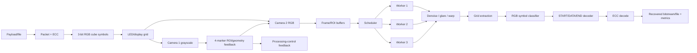

# CubeOCC — Project Source of Truth

> [!important]
> This vault separates **confirmed requirements**, **assistant recommendations**, and **open questions** so assumptions cannot silently become requirements.

## Navigation
- [[01_CONFIRMED_REQUIREMENTS]]
- [[02_OPEN_QUESTIONS_AND_AMBIGUITIES]]
- [[03_FRAME_AND_LINK_PROTOCOL]]
- [[04_TWO_CAMERA_FEEDBACK_SYSTEM]]
- [[05_FPGA_PROCESSING_PIPELINE]]
- [[06_SIMULATION_AND_TESTBENCH]]
- [[07_ECC_AND_METRICS]]
- [[08_ARCHITECTURE_RECOMMENDATIONS]]
- [[09_VERIFICATION_CHECKLIST]]
- [[10_DECISION_LOG]]
- [[11_MONTH_PLAN]]

## Whole-system view

## Update rule
1. Only put agreed facts in [[01_CONFIRMED_REQUIREMENTS]].
2. Put uncertain items in [[02_OPEN_QUESTIONS_AND_AMBIGUITIES]].
3. Record design changes in [[10_DECISION_LOG]].
4. Re-run [[09_VERIFICATION_CHECKLIST]] after changes.
