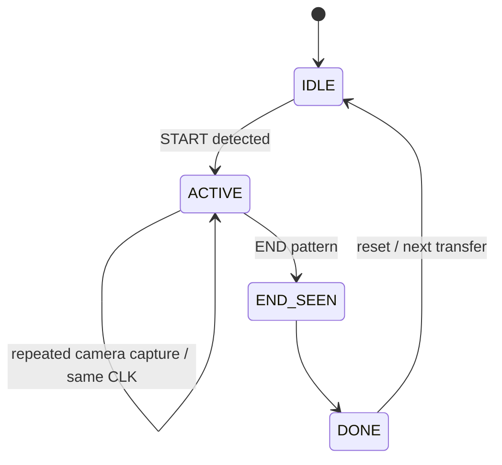

# Frame and Link Protocol

## Related Sender Tool Notes

- [[07_03_SENDER_FRAME_MAPPING]]
- [[07_04_SENDER_FRAME_PLAYER]]
- [[07_05_FULL_FRAME_GENERATION_WALKTHROUGH]]

## DATA frame — 8×8

```text
64 cells total
= 4 white corner markers
+ 1 CLK/toggle cell
+ 59 payload/ECC cells
```

V1 grayscale mode:

```text
59 cells x 1 bit/cell = 59 coded bits
```

V1.5 RGB mode:

```text
59 cells x 3 bits/cell = 177 coded bits
```

### Normal DATA invariants

- TL = white marker
- TR = white marker
- BL = white marker
- BR = white marker
- CLK = toggles on each newly transmitted DATA frame
- V1: 59 remaining cells = grayscale/on-off symbols
- V1.5: 59 remaining cells = legal 8-state RGB symbols

> [!note]
> CLK location is configurable and architecturally unimportant.

## START

```text
All 64 cells = WHITE
```

- one optical frame
- no payload
- enters active transfer state

## END

```text
TL = WHITE
TR = WHITE
BL = WHITE
BR = BLACK/OFF
CLK = BLACK/OFF
all ordinary cells = BLACK/OFF
```

- one optical frame
- no payload

## Why black and white can still be legal DATA symbols

The protocol reserves **full-frame layouts**, not individual colors. Normal DATA can contain black and white cells freely.

## V1 / V1.5 Symbol Mapping

V1 starts with grayscale symbols for the first receiver implementation.

V1.5 adds direct RGB-to-bit mapping for all 8 legal DATA symbols:

```text
R = bit 2
G = bit 1
B = bit 0
```

In V1.5, each cube's on/off RGB state represents one 3-bit value.

## Receiver FSM



## Multiple camera captures of one optical frame

Example:

```text
Optical frame A / CLK=0 -> capture 1
Optical frame A / CLK=0 -> capture 2
Optical frame A / CLK=0 -> capture 3
Optical frame B / CLK=1 -> capture 4
```

Only the transition to the new CLK state commits a new optical DATA frame.

## Optional V2 sequence number

Not required in V1. A small sequence field can later be placed inside the protected payload to detect missed/duplicated transmitted frames. No machine learning is involved; it is only a small counter.

Padding bits left by ECC packing may be used for frame numbers or sequence metadata before adding shortened-code complexity.

## Missed Frame Policy

CubeOCC is one-way and UDP-like. The receiver does not request retransmission.

If Camera 2 completely misses one or more transmitted DATA frames:

- ignore the missing data and continue with later frames
- do not send feedback or retry requests to the transmitter
- report the event through debug/diagnostic output, such as FPGA serial output or a status pin

V2 sequence numbers may make missed-frame detection more explicit, but recovery is still forward-only.
