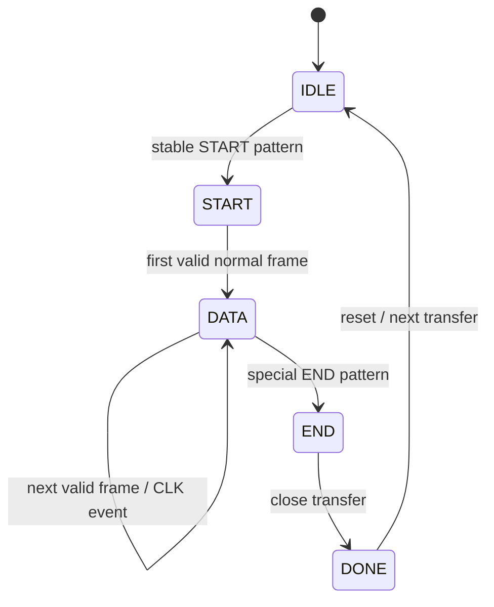

# Frame and Optical Link Protocol

## DATA capacity in 8×8 mode
`64 = 4 markers + 1 CLK + 59 coded data/ECC cells`

Each coded cell has 8 RGB states = 3 bits, therefore:

**59 × 3 = 177 coded bits per DATA frame.**

## Normal DATA invariants
- TL, TR, BL, BR corner markers = white.
- CLK toggles/changes between transmitted frames so identical payload patterns can still represent different frames.
- 59 other cells carry payload+ECC symbols.

## START
- Entire frame bright white.
- Marks start/preamble.
- Triggered by a simulated button in the testbench.

## END — exact latest definition
```text
TL marker = WHITE
TR marker = WHITE
BL marker = WHITE
BR marker = BLACK/OFF
CLK       = BLACK/OFF
all ordinary data cells = BLACK/OFF
```

> [!warning]
> The CLK physical coordinate is still TBD; do not hard-code a location from an earlier generated image.

## Suggested receiver state machine


## Important CLK limitation
The one-bit optical CLK distinguishes two identical adjacent transmitted frames, but alone it cannot prove that an even number of frames was not missed. A protected sequence number is therefore a recommendation, not yet a requirement.
