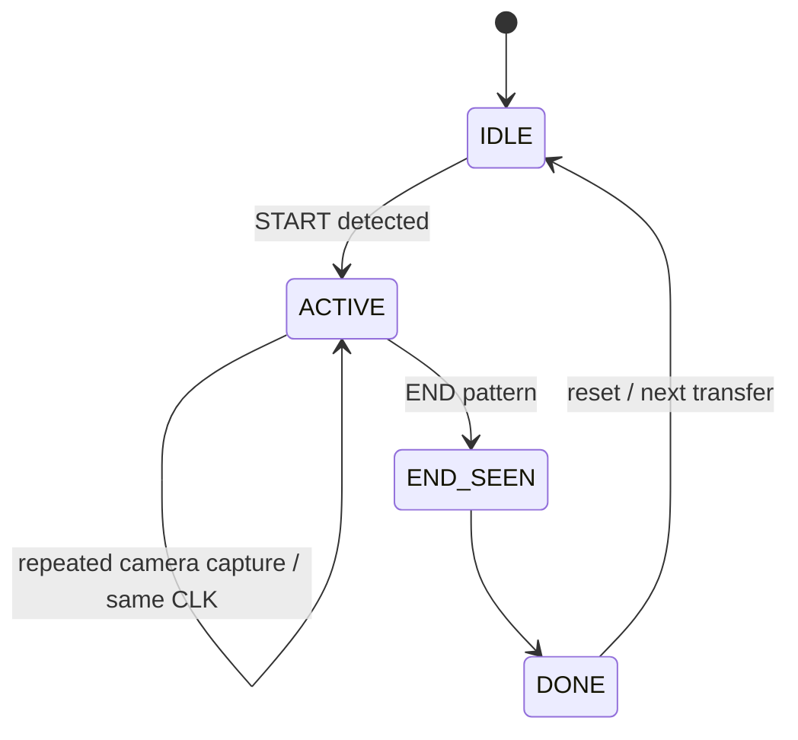

# Frame and Link Protocol

## DATA frame — 8×8

```text
64 cells total
= 4 white corner markers
+ 1 CLK/toggle cell
+ 59 RGB payload/ECC cells
```

**59 × 3 = 177 coded bits.**

### Normal DATA invariants

- TL = white marker
- TR = white marker
- BL = white marker
- BR = white marker
- CLK = toggles on each newly transmitted DATA frame
- 59 remaining cells = legal 8-state RGB symbols

> [!note]
> CLK location is configurable and architecturally unimportant.

## START

```text
All 64 cells = WHITE
```

- one optical frame
- no payload
- enters active transfer state

## END

```text
TL = WHITE
TR = WHITE
BL = WHITE
BR = BLACK/OFF
CLK = BLACK/OFF
all ordinary cells = BLACK/OFF
```

- one optical frame
- no payload

## Why black and white can still be legal DATA symbols

The protocol reserves **full-frame layouts**, not individual colors. Normal DATA can contain black and white cells freely.

## Receiver FSM



## Multiple camera captures of one optical frame

Example:

```text
Optical frame A / CLK=0 -> capture 1
Optical frame A / CLK=0 -> capture 2
Optical frame A / CLK=0 -> capture 3
Optical frame B / CLK=1 -> capture 4
```

Only the transition to the new CLK state commits a new optical DATA frame.

## Optional V2 sequence number

Not required in V1. A small sequence field can later be placed inside the protected payload to detect missed/duplicated transmitted frames. No machine learning is involved; it is only a small counter.
