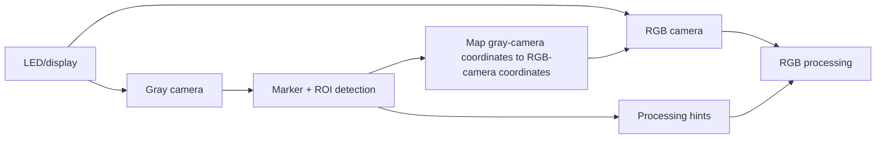

# Two-Camera Feedback System

## Camera 1
Low-quality grayscale tracking/feedback path.

Possible outputs:
```text
ROI rectangle
TL/TR/BL/BR marker positions
geometry / perspective estimate
tracking confidence
optional brightness / saturation / blur hints
```

## Camera 2
RGB data path, allowed to be slower, focused on the useful ROI.

## Feedback concept


## Critical state-aware behavior
Normal DATA expects 4 markers, but END deliberately turns BR off. Therefore a missing BR marker during an active transfer must not by itself mean END; END recognition should also check that CLK and the ordinary data cells are off and that the protocol state allows END.
