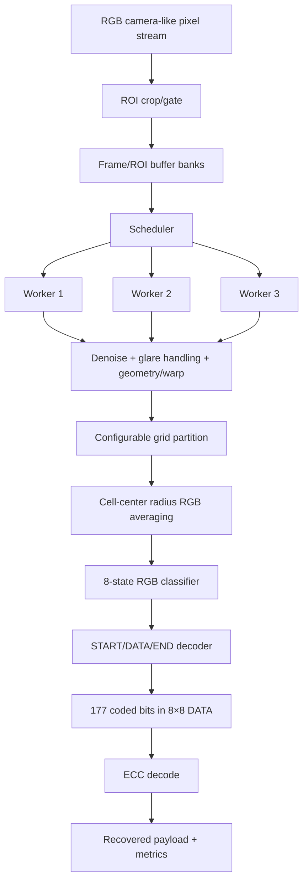

# FPGA Processing Pipeline

## Suggested buffer bank lifecycle
`FREE -> FILLING -> READY -> PROCESSING -> FREE`

Scheduler checks:
1. which worker is idle,
2. which image/ROI is READY,
3. which bank should be assigned,
4. when a bank can be freed.

## Processing options
### Denoise
- no-filter baseline
- 3×3 median
- small Gaussian
- bilateral-like approximation

### Glare/lighting
- reject saturated pixels
- local/white-marker normalization
- per-channel gain correction
- advanced restoration only as stretch work

### Geometry
- full homography warp
- direct marker-derived cell coordinates without full-frame warp
- LUT/precomputed mapping

### Classification
- Euclidean RGB distance to 8 ideal cube corners
- normalized RGB distance
- calibrated per-channel thresholding

## Parallelism choices
- **A: one streaming pipeline** — easiest MVP.
- **B: three full workers** — closest to original idea but costly.
- **C: hybrid replicated bottleneck blocks** — compromise.
