# V1 Streaming Pipeline

## Core rule

**Do not store full raw frames in V1 unless a specific stage proves it unavoidable.**

```mermaid
flowchart LR
    S[Camera 2 cropped ROI pixel stream] --> D[Denoise or bypass]
    D --> W[Warp / coordinate mapping]
    W --> G[Grid extraction]
    G --> A[Per-cell grayscale accumulators]
    A --> M[Per-cell averages]
    M --> T[Grayscale/on-off recovery]
    T --> F[Frame/link decoder]
    F --> E[ECC decoder]
    E --> O[Recovered bitstream]
```



## Storage inside V1

Allowed/expected:

- line buffers needed by small spatial filters
- small warp/LUT state
- grid/cell metadata
- grayscale accumulators per active cell
- pixel count per cell
- final per-cell average
- classified grayscale/on-off symbol
- ECC/codeword buffers
- packet/reassembly metadata

Avoid:

- complete raw frame in FFs
- multiple complete raw frames just to create parallelism

## Per-cell reduction

For pixels inside the selected sampling region:

```text
sum_gray += pixel_gray
count += 1
```

Then:

```text
avg_gray = sum_gray / count
```

After the cell result is finalized, raw pixels are no longer needed.

## V1.5 upgrade

V1.5 extends this same streaming structure to RGB:

- R/G/B accumulators per active cell
- per-channel averages
- RGB threshold/classification logic
- direct 3-bit symbol mapping

## Warp

Because current corner geometry is available every frame, V1 updates the grid mapping every frame.

Possible implementations:

- warp pixel coordinates then grid
- inverse-map output grid positions to input pixels
- directly derive cell boundaries from the quadrilateral without materializing a full rectified frame

## Output ordering

With one V1 pipeline, frames are inherently in order. Therefore no input scheduler, reorder buffer or waiting FIFO is needed unless benchmarking proves otherwise.
