# V1 Streaming Pipeline

## Core rule

**Do not store full raw frames in V1 unless a specific stage proves it unavoidable.**

```mermaid
flowchart LR
    S[Camera 2 cropped ROI pixel stream] --> D[Denoise or bypass]
    D --> W[Warp / coordinate mapping]
    W --> G[Grid extraction]
    G --> A[Per-cell grayscale accumulators]
    A --> M[Per-cell averages]
    M --> T[Grayscale/on-off recovery]
    T --> F[Frame/link decoder]
    F --> E[ECC decoder]
    E --> O[Recovered bitstream]
```

The current FPGA projective-warp implementation is the documented exception: it stores one 160x120 GRAY8 frame (19,200 bytes) in eight RAMB36 tiles because inverse source lookups are not sequential. It also uses one 160-byte row buffer so the iterative mapper can still emit a continuous DVP line. The ROI detector and 8x8 grid mapper remain streaming.



## Storage inside V1

Allowed/expected:

- line buffers needed by small spatial filters
- small warp/LUT state
- grid/cell metadata
- grayscale accumulators per active cell
- pixel count per cell
- final per-cell average
- classified grayscale/on-off symbol
- ECC/codeword buffers
- packet/reassembly metadata

Avoid:

- complete raw frame in FFs
- multiple complete raw frames just to create parallelism

## Per-cell reduction

For pixels inside the selected sampling region:

```text
sum_gray += pixel_gray
count += 1
```

Then:

```text
avg_gray = sum_gray / count
```

After the cell result is finalized, raw pixels are no longer needed.

## V1.5 upgrade

V1.5 extends this same streaming structure to RGB:

- R/G/B accumulators per active cell
- per-channel averages
- RGB threshold/classification logic
- direct 3-bit symbol mapping

## Warp

Because current corner geometry is available every frame, V1 updates the grid mapping every frame.

Possible implementations:

- warp pixel coordinates then grid
- inverse-map output grid positions to input pixels
- directly derive cell boundaries from the quadrilateral without materializing a full rectified frame

## Output ordering

With one V1 pipeline, frames are inherently in order. Therefore no input scheduler, reorder buffer or waiting FIFO is needed unless benchmarking proves otherwise.

## Implemented RTL checkpoint

See [[15_08_FPGA_CAMERA2_GRAYSCALE_GRID_REVIEW]] for commands, files, and review instructions.

Verified direct XSim chain:

```text
roi_start_detector
  -> projective_warp_160x120
  -> grayscale_grid_8x8
```

- 807 real grayscale capture frames completed;
- 19,200 warped output pixels per frame;
- 64 grid cells per frame and 300 pixels per cell;
- 51,648 total cell records;
- approximately 269,000 clocks per frame for capture plus the iterative projective warp;
- approximately 2.69 ms at 100 MHz or 11.2 ms at 24 MHz, before camera blanking;
- standalone projective-warp synthesis produced 5,206 LUT primitives, 887 flip-flops, 8 RAMB36 tiles, and 14 DSP48E1 blocks on `xc7a35tcpg236-1`.

The next image-processing stage is the per-cell circular sampler, grayscale averaging, and on/off classifier. Structural completion does not replace manual review of corner and grid geometry.
