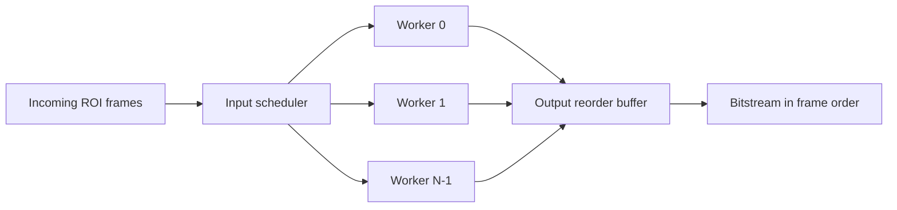

# Optional Scalable Parallel Pipelines

Implement only after benchmarking V1.

## Reusable pipeline module

Define one complete end-to-end processing worker and instantiate it `N` times only if required.



## Input scheduler

At frame start:

1. assign monotonic `frame_id`
2. find a free worker
3. send frame to that worker
4. tag worker/result with `frame_id`

Example:

```text
frame 1 -> worker 2
frame 2 -> worker 0
frame 3 -> worker 1
```

## Output reorder buffer

If results finish:

```text
frame 2
frame 1
frame 3
```

the reorder buffer releases:

```text
frame 1
frame 2
frame 3
```

## When every worker is busy

A scheduler cannot queue an incoming raw frame without storage.

Options:

### A. One shared overflow buffer

- one shared buffer, not one per worker
- used only if every worker is busy
- depth selected from measured worst case

### B. Sensor/backpressure control

If physical sensor/interface permits delaying new frames.

### C. Frame drop

Explicitly mark a missed frame if neither buffering nor backpressure is available.

> [!important]
> The shared FIFO/buffer is optional. It is not needed when one worker can sustain the camera rate.
