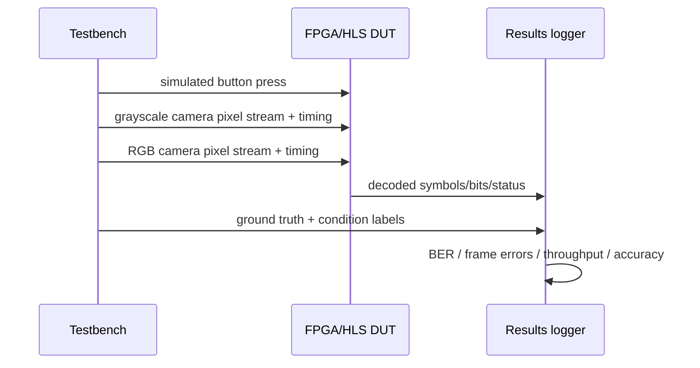

# Simulation and Testbench

## Objective
Make the testbench act like a real button + two camera sources rather than a perfect image-function caller.

## Initial dataset
Use phone captures of a generated LED/screen grid on a laptop/display under labeled conditions such as angle, distance, glare, brightness, blur, exposure, and color shift.

## Suggested flow


## Camera-like interface options
- AXI4-Stream Video style.
- Custom `pixel_valid`, `line_valid`, `frame_valid`, `frame_start`.
- HLS streams preserving real pixel order and frame boundaries.

## Faults to simulate
- [ ] repeated payload image with CLK change
- [ ] duplicate capture
- [ ] skipped capture
- [ ] camera timing offset
- [ ] noisy/missing marker
- [ ] false dark/END-like frame
- [ ] saturated/glare cells
- [ ] severe perspective
- [ ] wrong white balance
- [ ] slightly wrong ROI

## Suggested CSV columns
```csv
run_id,frame_id,condition,grid_size,ecc_mode,denoise_mode,warp_mode,marker_ok,start_ok,end_ok,tx_bits,rx_bits,bit_errors,ber,symbol_errors,latency_cycles
```
