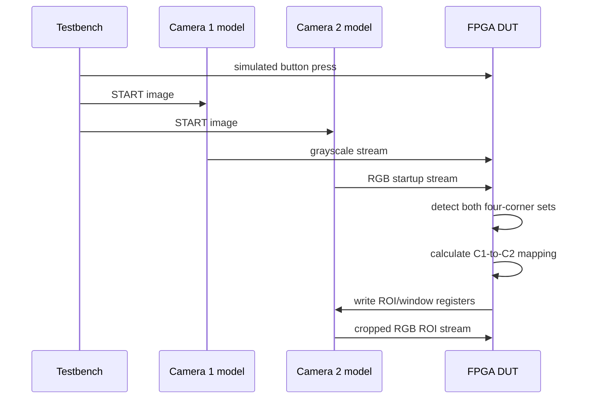
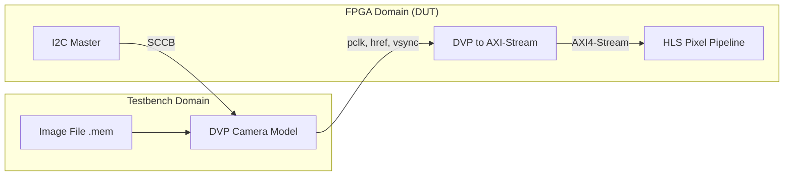

# Simulation Camera Model

## Goal

The FPGA code should interact with the testbench as if the testbench were an actual camera sensor.
Long-term goal: replace the simulated camera with a real physical camera without redesigning the core FPGA receiver.

## Current Status

- **DVP Model:** Active and passing regression tests. (Primary V1 target)
- **MIPI Model:** Active and passing regression tests. (Deferred to V2 for physical hardware)
- Both models simulate OV5640 behavior, including 16-bit SCCB register addresses (e.g., `0x3800` for HSTART) and true hardware ROI windowing (FPS increases as window shrinks).

## Dual Camera Simulation Strategy

The CubeOCC architecture uses two cameras (Camera 1 for Grayscale tracking, Camera 2 for RGB data). In the simulation environment, both cameras use the exact same `dvp_camera_model` module. There is no need to write a separate module for Camera 1. The distinction is handled by the testbench parameters:

- **Camera 1 (Tracking):** Driven at a higher frame rate (~60 FPS target), and the testbench feeds it grayscale or down-scaled image data.
- **Camera 2 (Data):** Driven at a lower frame rate (~30 FPS target), and the testbench feeds it the full RGB image data.

## Architecture & Philosophy

The camera models are **Behavioral SystemVerilog Testbenches**. They are not synthesizable and do not consume FPGA resources (LUTs/FFs/BRAMs). They run purely in the computer's memory (XSim) to emulate a physical OV5640 sensor. This allows FPGA RTL code to be developed and debugged before physical hardware is available.

## DVP Camera Interface Contract (For FPGA RTL)

When writing the FPGA-side RTL (I2C Master & DVP-to-AXIS), it must connect to these conceptual interfaces:

### 1. Control Bus (SCCB / I2C)

The FPGA I2C Master will write to 16-bit addresses to configure the sensor.

- `REG_STREAM_ENABLE` (`0x3008`): Turns pixel streaming on/off.
- `REG_ROI_HSTART` (`0x3800`): Horizontal start coordinate.
- `REG_ROI_VSTART` (`0x3802`): Vertical start coordinate.
- `REG_ROI_HSIZE` (`0x3804`): ROI Width.
- `REG_ROI_VSIZE` (`0x3806`): ROI Height.

### 2. Pixel Data Stream (DVP)

The DVP-to-AXI4-Stream module will read these signals from the camera:

- `pclk`: Pixel clock (driven by camera).
- `vsync`: Frame start/active (Active Low during frame, High during blanking).
- `href`: Horizontal reference (Active High when pixel data is valid).
- `pixel_data [7:0]`: 8-bit pixel value.
- `sof`: Start of frame marker (convenience signal for simulation).

## Sensor-level crop simulation

Correct conceptual flow:

```text
full source image in testbench
  -> simulated sensor register window
  -> only cropped ROI appears on Camera 2 pixel bus
  -> FPGA receives cropped stream
```

_(Not: FPGA receives full image -> FPGA crops it)_

## Testing & Image Loading Mechanism

### Current State

The testbench currently uses a mathematical test pattern (**`test_pixel(row, col)`**) to verify timing, ROI boundaries, and FPS behavior.

### V1 Image Loading Plan (Real OCC Data)

To test actual CubeOCC LED grids:

1. **Image to Memory File:** A Python script will convert real captured photos (e.g., phone picture of an 8x8 LED grid) into a hex text file (**`.mem`** or **`.txt`**).
2. **Testbench Loading:** The SystemVerilog testbench will use **`$readmemh`** to load this image file into a local memory array.
3. **ROI Streaming:** When the FPGA configures the ROI registers, the camera model will read only the corresponding pixels from the memory array and output them on the DVP interface.



## Dataset conditions (For V1/V2 Testing)

- distance
- viewing angle
- brightness
- glare/reflection
- blur
- exposure
- screen brightness
- grid size
- capture FPS
- optical frame rate

Glare is included as a condition, not a correction feature.

## Faults to simulate (For V1/V2 Testing)

- repeated captures of same CLK
- new optical frame / CLK toggle
- skipped optical frame
- bad marker confidence
- mapping error
- wrong ROI
- low brightness
- blur
- glare as impairment
- START
- END
- all 8 legal RGB DATA symbols

## System Integration Flow



## Regression Test Results (2026-08-23)

| **Case**   | **Resolution** | **DVP FPS** | **MIPI FPS** | **Status** |
| ---------- | -------------- | ----------- | ------------ | ---------- |
| A (Full)   | 2592x1944      | 16          | 78           | PASS       |
| B (Half)   | 2592x972       | 31          | 156          | PASS       |
| C (Narrow) | 128x720        | 168         | 3343         | PASS       |

## Regression Update (2026-08-26) — Top-Level Integration

| **Case** | **Chain** | **Check** | **Status** |
| -------- | --------- | --------- | ---------- |
| `cubeocc_top_tb` | DVP model → dvp_to_axis → cubeocc_hls_0 → AXIS | 92,160 pixels (128x720) **and** 720 lines (tlast) | PASS |

- Fixed a simulation race: the DVP model used to drive `href`/`pixel_data` with blocking assigns concurrent to `posedge pclk`, which could suppress `m_axis_tlast` (end-of-line) in `dvp_to_axis`. Outputs are now driven on `negedge pclk`.
- **Driving convention:** all camera models must drive DVP outputs on `negedge pclk` (see Decision Log 2026-08-26). The MIPI model must be audited for the same pattern before V2 use.
