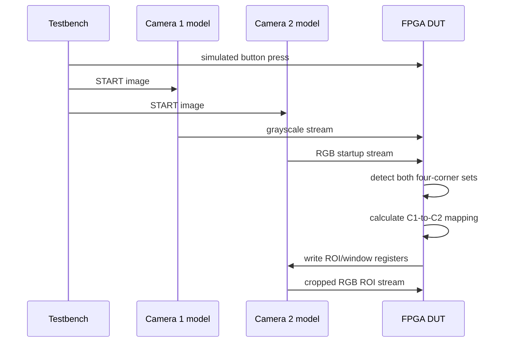

# Simulation Camera Model

## Goal

The FPGA code should interact with the testbench as if the testbench were an actual camera sensor.

Long-term goal: replace the simulated camera with a real physical camera without redesigning the core FPGA receiver.

## Camera register model

Model relevant sensor registers such as:

```text
ROI_X_START
ROI_Y_START
ROI_WIDTH
ROI_HEIGHT
EXPOSURE / gain placeholders if needed
STREAM_ENABLE
FRAME_STATUS
```

Camera 1/control logic writes ROI information. Camera 2 model uses those registers to determine which pixels are emitted.

## Sensor-level crop simulation

Correct conceptual flow:

```text
full source image in testbench
-> simulated sensor register window
-> only cropped ROI appears on Camera 2 pixel bus
-> FPGA receives cropped stream
```

Not:

```text
FPGA receives full image
-> FPGA crops it
```

## Pixel-stream interface

Exact sensor is still TBD. Define an abstraction that can later map cleanly to the chosen device, e.g.:

```text
pixel_data
pixel_valid
line_valid
frame_valid
frame_start
```

or AXI4-Stream Video if selected.

## Startup sequence



## Dataset conditions

- distance
- viewing angle
- brightness
- glare/reflection
- blur
- exposure
- screen brightness
- grid size
- capture FPS
- optical frame rate

Glare is included as a condition, not a correction feature.

## Faults to simulate

- repeated captures of same CLK
- new optical frame / CLK toggle
- skipped optical frame
- bad marker confidence
- mapping error
- wrong ROI
- low brightness
- blur
- glare as impairment
- START
- END
- all 8 legal RGB DATA symbols
